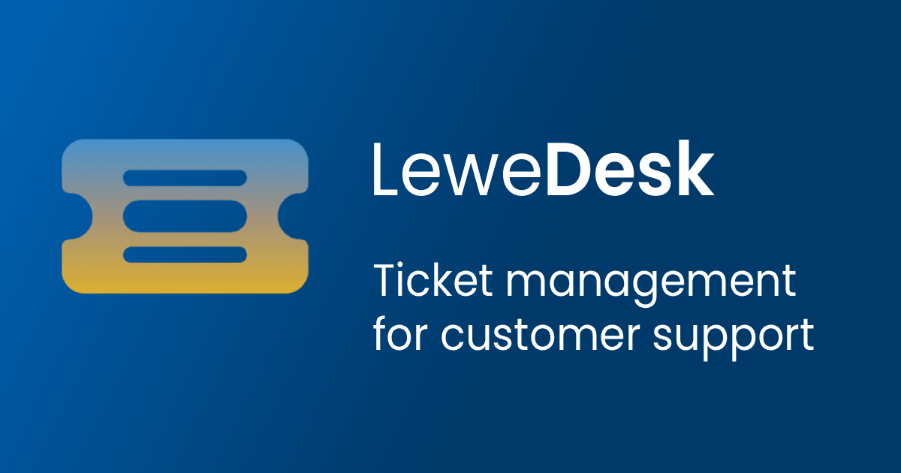
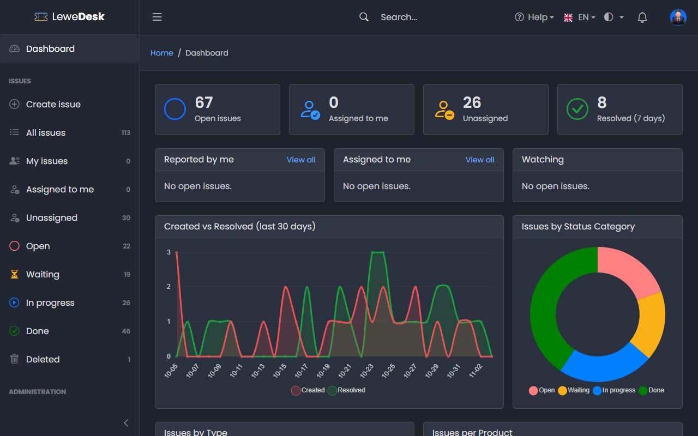
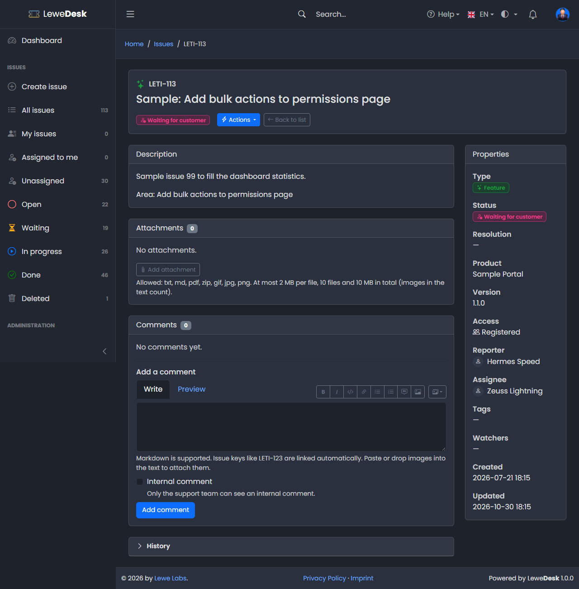

# LeweDesk

**A web based issue tracker (ticket system) for customer support.** Customers report problems, ask questions and request improvements in one central place. Your support team works through them with a configurable status workflow, comments, internal notes and a full history of every change.

LeweDesk is a PHP and MySQL application that runs on ordinary web hosting: copy the files, create a database, run the installer in the browser.

## Features

### Issues
* Issues with types, status, resolutions, products, versions and tags
* Workflow actions: Respond, Resolve, Close, Reopen, Assign, Watch and more
* Markdown comments with inline images, and internal notes only the support team can see
* Attachments with size and count limits
* A complete history of every change on an issue
* Search and quick views such as *My issues*, *Assigned to me* and *Unassigned*

### People and access
* Roles, groups and permissions
* Every issue is *Public*, *Registered* or *Reporter only*
* Self registration, or accounts managed by an administrator
* Two factor authentication (TOTP), LDAP login and single sign-on with OpenID Connect

### Staying informed
* Notifications in the application and by email, per user and event
* Dashboard with statistics and charts

### Built for operation
* Audit log of administrative and security events
* Spam protection with hourly limits, and a throttle for wrong passwords
* Dark and light mode; English, German, French and Spanish
* Housekeeping (mail retry, cleanup) runs inside the application, no cron job needed

## Requirements

| What | Needed |
|---|---|
| Web server | Apache 2.4 with `mod_rewrite` (nginx works too) |
| PHP | 8.1 or newer with `pdo_mysql`, `mbstring`, `openssl`, `curl`, `json`, `ctype` |
| Database | MySQL 8 or MariaDB 10.5+ |
| Mail | Optional SMTP server for notifications and password reset |

## Installation in short

1. Create an empty database (utf8mb4) and a user for it.
2. Copy the content of this repository to your web server folder.
3. Open `install.php` in the browser and follow the page. It checks the server, creates the tables, writes the configuration and locks itself.
4. Log in as `admin`, set a password if the installer did not ask for one, and delete `install.php`.

The full guide, with web server notes, cron jobs, upgrading and troubleshooting, is **[INSTALL.md](INSTALL.md)**.

## What is in this repository

The **ready to run application**: the built frontend, the PHP API, the database scripts (`db/`) and the installer. It is not the source code of the frontend.

| Path | Content |
|---|---|
| `index.html`, `assets/`, ... | The application pages |
| `api/` | The PHP API |
| `db/` | `db_init.sql` (structure and base data) and optional sample data |
| `install.php` | The web installer (delete it after the installation) |
| `.env.example` | All configuration keys with comments |
| `INSTALL.md`, `CHANGELOG.md` | Installation guide and release notes |

## Product Page

Check the product page at: https://lewedesk.lewe.com

## Documentation

The user and administrator manual is on GitBook: https://lewe.gitbook.io/lewedesk

## Support and issues

Please report bugs and ideas at https://desk.lewe.com (Where else if not in LeweDesk itself :-) )

## License

See [LICENSE](LICENSE).
